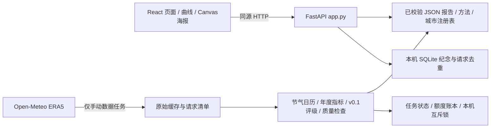

# 开发交接文档

## 1. 项目概况与交接边界

《节气讣告——家乡旧候纪念馆》让观众选择家乡，阅读节气历史气候画像、打开年度曲线、点灯献花并导出纪念图片。六城优先接入（北京、哈尔滨、西安、上海、成都、广州）扩展为34个省级行政区代表城市共用架构，当前真实报告7城（新增天津），并非34城计算完成。独立样例是合成数据，不替代失败的真实报告。

本次交接版本为 handoff-v1，准确版本用 `git rev-parse HEAD` 查看；本文件随所在提交版本化，避免在提交中写入自身SHA。数据读取时间见下表及 `交接数据快照.json`。原开发记录是历史证据，当前结论以本次快照及实际报告为准。原策划书、截图批次、个人数据库和基线压缩包留在原机，不是运行依赖。

## 2. 架构与版本

前端实际锁定版本：react 19.3.1、typescript 5.9.3、vite 7.3.7、echarts 6.1.0。后端 requirements.txt 锁定 FastAPI 0.162.0、Pydantic 2.14.1、Uvicorn 0.54.0、NumPy 2.5.4、Pandas 3.1.0、Skyfield 1.55；Python实测3.13.5，Node实测24.18.0，npm 11.16.0。SQLite由Python标准库提供。



生产式本机启动由FastAPI同时提供dist与API，页面无需外网；初次安装依赖需要网络。开发时Vite代理 `/api` 到127.0.0.1:8765；如果后端选到其他端口，先处理端口占用或调整 vite.config.ts 代理后再开发，不能指向旧服务。

## 3. 代码导航

| 路径（均相对仓库） | 用途 |
|---|---|
| demo/frontend/src/App.tsx | 入口体验、城市选择、档案、图表生命周期、纪念与预览组件 |
| demo/frontend/src/main.tsx、style.css | React挂载、已有视觉样式 |
| demo/frontend/src/api.ts | fetch超时/取消、健康探测、HTTP错误；业务调用在App.tsx |
| demo/frontend/src/report.ts、types.ts | 浏览器侧报告校验、共享形状 |
| demo/frontend/src/poster.ts | Canvas 1080×1440绘制、PNG导出 |
| demo/backend/app.py | create_app应用工厂、全部路由、SQLite自动建表 |
| demo/scripts/report_schema.py、report_validation.py | Pydantic形状及身份/坐标/来源/年度/指标/摘要/敏感性验证 |
| demo/config/cities.json、scripts/city_registry.py | 城市唯一来源、读取和查找 |
| demo/scripts/build_beijing.py | 原始数据解析、Skyfield日历、节气窗口年度聚合；兼容北京入口 |
| demo/scripts/climate.py | make_term、score_metrics、classify、sensitivity、common_report |
| demo/scripts/build_cities.py | Runner.chunk/build_city/publish/run；Budget.reserve；batch_lock；required_periods；find_cache |
| demo/scripts/build_demo.py | 显式合成样例生成，仅缺样例时准备脚本调用 |
| demo/run.py、prepare.ps1、各cmd | 首次安装、启动、关闭和明确手动数据入口 |
| demo/tests | 45项基础回归；真实缓存仅依赖提交的小片和日历 |
| demo/qa | 浏览器及数据审计脚本；生成产物被忽略 |
| demo/CONTRACT.md | 数据和API共享契约，修改接口时共同维护 |

报告 schema_version=1.0、method_version=v0.1，顶层包括city、source、baseline、recent、quality、terms。terms固定24项，每项含status、score、metrics、annual（65年）、sensitivity。前端显示数据层评级，不重复计算科学结果。

## 4. 新电脑部署：从零到运行

安装Git、Python3.13（建议64位并安装py启动器）、Node22.12+（建议24）和系统中文字体。依赖版本以两个锁文件为准，先运行 `py -3.13 --version`、`node --version`、`npm.cmd --version`。

```powershell
git clone https://github.com/Jc-augenstern/24_Solar_Terms.git
cd 24_Solar_Terms\demo
powershell.exe -NoProfile -ExecutionPolicy Bypass -File .\prepare.ps1
.\启动作品.cmd
```

准备脚本的等价分步操作：

```powershell
py -3.13 -m venv .venv
.\.venv\Scripts\python.exe -m pip install -r requirements.txt
cd frontend
npm.cmd ci
npm.cmd run build
cd ..
.\.venv\Scripts\python.exe -X utf8 run.py --background
```

无需激活虚拟环境。报告、方法、城市配置已随仓库提供；首次纪念查询或提交自动创建data目录下SQLite及两张表（tributes、request_keys），不需要复制原机正式库。首次启动自动创建data/runtime。先确认首页、样例城和任一已完成城可以打开24项档案。

```powershell
Invoke-RestMethod http://127.0.0.1:8765/api/health
(Invoke-RestMethod http://127.0.0.1:8765/api/v1/cities).cities | Group-Object data_status
(Invoke-RestMethod http://127.0.0.1:8765/api/v1/cities/beijing/report).terms.Count
.\.venv\Scripts\python.exe -m pytest tests -q
.\关闭作品.cmd
```

如果端口变化，以上URL换成启动器输出。无需配置密钥和.env，项目不自动加载.env。可在PowerShell设置 `$env:DEMO_DB_PATH = Join-Path $env:TEMP 'jieqi-test.sqlite3'`，并把DEMO_STATE_DIR设为单独临时目录；DEMO_DATA_DIR可替换数据目录（其中须有reports与methodology）。普通开发无需设置。关闭测试服务时使用同样的环境变量。

前端热更新：先启动后端，在另一个终端进入demo/frontend执行 `npm.cmd run dev`，打开Vite输出地址。修改完成运行build，正式页面才会更新。

浏览器完整检查：安装Google Chrome后，在demo运行 `node qa/browser_multicity.mjs`，脚本使用隔离数据库、实际Windows入口并验证PNG和应用级断网。它不下载天气；失败详情留在qa/multicity。`qa/verify_multicity.py`、`qa/verify_report.py`需要完整原始数据；`qa/check_beijing_baseline.py`另需原机私有基线，不能在纯克隆中把缺文件视为通过。

## 5. 全部后端API

实现均在backend/app.py，前端通用入口api.ts、业务调用App.tsx。API没有启用Swagger、ReDoc或OpenAPI路由。city_id为注册表ID或demo。

| 方法/路径 | 输入 | 成功结构及来源 | 主要失败 |
|---|---|---|---|
| GET /api/health | 无 | {ok,instance_id}，内存实例 | 网络/服务未启动 |
| GET /api/v1/cities | 无 | {cities:[城市元数据,data_status,reason,update_status,update_reason,last_success_report],demo}；注册表+实际校验报告+可选任务状态 | 单城错误作为状态返回 |
| GET /api/v1/cities/{city_id}/report | 城市ID | 完整Report；data/reports/{id}.json | 404未知/应有文件缺失；503未接入/准备/获取受阻；500读取/JSON/契约失败 |
| GET /api/v1/methodology/{version} | 仅v0.1 | 方法JSON，data/methodology/v0.1.json | 404 unknown_method/method_missing；500 invalid_method |
| GET /api/v1/cities/{city_id}/tributes | 可选experience_id | total/light/flower/terms/recorded；SQLite本机统计 | 报告错误；422参数错误；503 storage_failed |
| POST /api/v1/cities/{city_id}/tributes | JSON见下 | 上述计数加recorded_now；事务提交后返回 | 404 unknown_term；409 idempotency_conflict；422校验；503 storage_failed |
| POST /api/internal/shutdown | X-Shutdown-Token | {ok:true}；仅启动器调用 | 403 invalid_shutdown_token |
| GET /{asset_path:path} | dist相对文件路径 | 页面及静态资源 | 404 asset_missing/unknown_endpoint；首页未构建503 frontend_missing |

POST仅接受同源Origin（存在且不匹配返回403 origin_rejected），Host限127.0.0.1、localhost及测试testserver。常规错误形如 `{"detail":{"code":"unknown_city","message":"..."}}`；Pydantic的422使用标准detail数组。接口不是面向公网部署的多用户服务。

纪念请求示例（自造测试标识，不含个人数据）：

```json
{"experience_id":"dev-session-0001","term_id":"lichun","action":"light","idempotency_key":"dev-request-0001"}
```

experience_id和idempotency_key长度8—128，只允许字母数字及 `_ . : -`；term_id长度1—48、仅小写字母数字及 `_ -`；action仅light或flower；多余字段拒绝。新测试库第一次成功示例：

```json
{"total":1,"light":1,"flower":0,"terms":{"lichun":{"light":1,"flower":0}},"recorded":[{"term_id":"lichun","action":"light"}],"recorded_now":true}
```

相同自然键（城市/模式/体验/节气/动作）或请求重试不重复计数。相同幂等键用于不同操作返回409。真实报告与demo、不同城市严格隔离。开始新体验可再次纪念，历史保留。SQLite WAL与唯一约束处理并发，不代表全国人数。

## 6. 从天气到艺术指数

ERA5请求 → 分片JSON与meta SHA256 → Skyfield/JPL DE421逐年交节日期 → 北京时间UTC+08:00窗口 → 年度温度/日均降水/昼夜温差 → 历史比较 → v0.1指数 → 深层报告验证 → 原子发布JSON → 前端。

build_cities.required_periods从日历推导跨年补片，默认每城14片；find_cache核对参数和哈希；Runner.chunk记录尝试、预算、响应和断点。build_beijing负责校验日序列、单位和窗口；climate.make_term统计两时期，score_metrics计算 `D=Σ w×abs(近期均值−历史均值)/max(历史年度样本标准差,最小尺度)`，`S=100/(1+D)`。

历史1961—1990、近期1996—2025，1991—1995仅用于连续曲线。温度/日均降水/昼夜温差权重0.60/0.25/0.15，最小尺度分别0.5℃/0.5mm每日/0.5℃。年度有效日须90%，各比较期至少27个有效年度；缺失不填零。70及以上健在、40及以上病危、低于40已故，原始精度判断后显示舍入；不满足门槛是资料不足。16种单参数扰动输出敏感性提示，不是统计置信度。

方法变更须另立版本、共同审阅契约并复核北京基线，不得顺手改权重。北京已认可9健在/14病危/1已故，立秋38.8978234429且敏感；publish拒绝悄悄替换科学结果变化的北京报告。艺术评级不表示节气在天文学意义消失，也不是自然剩余百分比。

## 7. 当前逐城状态

2026-11-09T01:39:30.873746-04:00。数据来自磁盘任务记录、逐片SHA256及validate_report实际检查。缓存列为原机持有量，不代表Git内数量；API可访问指实际报告校验后的可用性，本次新克隆浏览器验证另见交付验证记录。任务状态为原机历史账本，额度恢复时间不保证提供方即时剩余额度。

| 城市 | 获取状态 | 哈希通过缓存 | 计算/报告 | 质量检查 | 前端真实报告 | 下一步 |
|---|---|---|---|---|---|---|
| 北京 | 已完成 | 14/14 | 已计算/已发布 | 报告通过 | 可用 | 已发布；继续使用稳定报告 |
| 天津 | 已完成 | 14/14 | 已计算/已发布 | 报告通过 | 可用 | 已发布；继续使用稳定报告 |
| 上海 | 已完成 | 14/14 | 已计算/已发布 | 报告通过 | 可用 | 已发布；继续使用稳定报告 |
| 重庆 | 额度阻塞 | 11/14 | 未发布 | 尚无报告 | 不可用；仅状态入口 | 保留缓存，指定唯一下载负责人后续跑 |
| 石家庄 | 额度阻塞 | 0/14 | 未发布 | 尚无报告 | 不可用；仅状态入口 | 等待下载负责人按额度串行获取 |
| 太原 | 额度阻塞 | 0/14 | 未发布 | 尚无报告 | 不可用；仅状态入口 | 等待下载负责人按额度串行获取 |
| 沈阳 | 额度阻塞 | 0/14 | 未发布 | 尚无报告 | 不可用；仅状态入口 | 等待下载负责人按额度串行获取 |
| 长春 | 额度阻塞 | 0/14 | 未发布 | 尚无报告 | 不可用；仅状态入口 | 等待下载负责人按额度串行获取 |
| 哈尔滨 | 已完成 | 14/14 | 已计算/已发布 | 报告通过 | 可用 | 已发布；继续使用稳定报告 |
| 南京 | 额度阻塞 | 0/14 | 未发布 | 尚无报告 | 不可用；仅状态入口 | 等待下载负责人按额度串行获取 |
| 杭州 | 额度阻塞 | 0/14 | 未发布 | 尚无报告 | 不可用；仅状态入口 | 等待下载负责人按额度串行获取 |
| 合肥 | 额度阻塞 | 0/14 | 未发布 | 尚无报告 | 不可用；仅状态入口 | 等待下载负责人按额度串行获取 |
| 福州 | 额度阻塞 | 0/14 | 未发布 | 尚无报告 | 不可用；仅状态入口 | 等待下载负责人按额度串行获取 |
| 南昌 | 额度阻塞 | 0/14 | 未发布 | 尚无报告 | 不可用；仅状态入口 | 等待下载负责人按额度串行获取 |
| 济南 | 额度阻塞 | 0/14 | 未发布 | 尚无报告 | 不可用；仅状态入口 | 等待下载负责人按额度串行获取 |
| 郑州 | 额度阻塞 | 0/14 | 未发布 | 尚无报告 | 不可用；仅状态入口 | 等待下载负责人按额度串行获取 |
| 武汉 | 额度阻塞 | 0/14 | 未发布 | 尚无报告 | 不可用；仅状态入口 | 等待下载负责人按额度串行获取 |
| 长沙 | 额度阻塞 | 0/14 | 未发布 | 尚无报告 | 不可用；仅状态入口 | 等待下载负责人按额度串行获取 |
| 广州 | 已完成 | 14/14 | 已计算/已发布 | 报告通过 | 可用 | 已发布；继续使用稳定报告 |
| 海口 | 额度阻塞 | 0/14 | 未发布 | 尚无报告 | 不可用；仅状态入口 | 等待下载负责人按额度串行获取 |
| 成都 | 已完成 | 14/14 | 已计算/已发布 | 报告通过 | 可用 | 已发布；继续使用稳定报告 |
| 贵阳 | 额度阻塞 | 0/14 | 未发布 | 尚无报告 | 不可用；仅状态入口 | 等待下载负责人按额度串行获取 |
| 昆明 | 额度阻塞 | 0/14 | 未发布 | 尚无报告 | 不可用；仅状态入口 | 等待下载负责人按额度串行获取 |
| 西安 | 已完成 | 14/14 | 已计算/已发布 | 报告通过 | 可用 | 已发布；继续使用稳定报告 |
| 兰州 | 额度阻塞 | 0/14 | 未发布 | 尚无报告 | 不可用；仅状态入口 | 等待下载负责人按额度串行获取 |
| 西宁 | 额度阻塞 | 0/14 | 未发布 | 尚无报告 | 不可用；仅状态入口 | 等待下载负责人按额度串行获取 |
| 呼和浩特 | 额度阻塞 | 0/14 | 未发布 | 尚无报告 | 不可用；仅状态入口 | 等待下载负责人按额度串行获取 |
| 南宁 | 额度阻塞 | 0/14 | 未发布 | 尚无报告 | 不可用；仅状态入口 | 等待下载负责人按额度串行获取 |
| 拉萨 | 额度阻塞 | 0/14 | 未发布 | 尚无报告 | 不可用；仅状态入口 | 等待下载负责人按额度串行获取 |
| 银川 | 额度阻塞 | 0/14 | 未发布 | 尚无报告 | 不可用；仅状态入口 | 等待下载负责人按额度串行获取 |
| 乌鲁木齐 | 额度阻塞 | 0/14 | 未发布 | 尚无报告 | 不可用；仅状态入口 | 等待下载负责人按额度串行获取 |
| 台北 | 额度阻塞 | 0/14 | 未发布 | 尚无报告 | 不可用；仅状态入口 | 等待下载负责人按额度串行获取 |
| 香港 | 额度阻塞 | 0/14 | 未发布 | 尚无报告 | 不可用；仅状态入口 | 等待下载负责人按额度串行获取 |
| 澳门 | 额度阻塞 | 0/14 | 未发布 | 尚无报告 | 不可用；仅状态入口 | 等待下载负责人按额度串行获取 |

尚未发布27城，重庆11片、其余26城0片。下载预算阻塞不会产生“资料不足”评级。没有全量34城验收完成的结论。

## 8. 数据协作、断点与已知问题

Git可直接获得7份真实报告（每份约1.06MB）、demo、方法、注册表、日历和一个约60KB缓存测试片。逐份大小与SHA256见交接数据快照。报告保留来源、模型、坐标、生成时间及方法；raw清单路径是来源指针，纯克隆不保证对应全量证据存在。

原机raw、batch_tasks、request_budget及正式库不进Git。原始包安全移交步骤与许可见[数据来源与交接](数据来源与交接.md)。本机batch_lock不能防止另一台电脑下载：指定唯一下载负责人；舍友默认离线开发。移交下载权时先等原任务停止，由原负责人复制稳定缓存与两份状态文件、核对SHA256，再启动接收机；旧机不再续跑。不要删除预算账本以“解除”限制，也不要同时使用同一共享IP重复拉取。

只有获准承担数据任务后才使用以下命令（均在demo）：

```powershell
.\.venv\Scripts\python.exe -X utf8 scripts/build_cities.py --city chongqing
.\.venv\Scripts\python.exe -X utf8 scripts/build_cities.py --resume
.\.venv\Scripts\python.exe -X utf8 scripts/build_cities.py --city beijing --offline
.\.venv\Scripts\python.exe -X utf8 scripts/build_cities.py --check
```

--resume跳过有效已发布报告；--offline只用缓存，但会进行计算和发布，应在接收机副本中执行。--check不联网但写本地report_check.json。--refresh会明确重取，普通接手不得使用。--all对应更新全部城市，绝不是首次准备步骤。退出2表示有受阻/未完成项，断点保留。

已完成：34城选择、7城报告、样例、北京视觉、曲线、跨城隔离、SQLite幂等、PNG导出与应用级离线机制。进行中且受额度阻塞：27城气象数据，优先重庆剩余3片。待开发与验收按优先级：

1. P0：补齐缓存的安全移交、单下载负责人约定、状态与额度观测；禁止自动重复消费额度。
2. P1：舍友维护API契约、错误状态、事务与跨城隔离回归，逐城数据完成后独立审计再发布；我负责真实页面、窄屏、海报长标题及视觉终审。
3. P2：测量城市列表深校验与大JSON响应性能后再优化缓存失效；PNG需系统中文字体，不捆绑Windows字体；全34城回归及真实用户/专家内容审阅尚未完成。

历史qa证据不随源码全部上传。原机专用check_beijing_baseline及策划文档路径是历史审计依赖，不是启动依赖。基础pytest目前存在Starlette/httpx弃用警告，升级测试客户端应独立开PR，不能趁交接改后端栈。

## 9. 双人分工与Git规范

我主责frontend/src的交互、样式、页面和最终设计验收；舍友主责backend、scripts、数据任务及后端测试。共同审核config、报告schema、types.ts、CONTRACT.md与方法版本。改共享核心文件前在PR说明范围，避免两人同时改同一契约。

main保存检查通过的稳定版本，每项任务独立feature分支；提交前先fetch，工作区干净后合并最新main，不覆盖他人未提交修改。示例：

```powershell
git switch main
git pull --ff-only origin main
git switch -c feature/backend-report-status
# 修改、测试，只暂存本任务文件
git add demo/backend/app.py demo/tests/test_backend.py
git diff --cached
git commit -m "fix(backend): clarify report status errors"
git fetch origin
git merge origin/main
# 若有冲突，阅读双方实现并解决，再重新运行相关测试
git push -u origin feature/backend-report-status
```

在GitHub Compare & pull request创建PR，请另一人审阅。标题建议 feat/fix/docs/test/chore(scope): 描述；PR写清问题、行为改变、测试和数据影响。至少pytest/build相关检查通过再合并，影响交互再浏览器验收。合并后 `git switch main`、`git pull --ff-only origin main`。不要强制push、reset --hard、clean -fd。未完成工作先在自己的分支明确提交或保留工作区，不执行会覆盖它的同步操作。

分支保护/必需审核属于GitHub管理员设置，本文规定工作流程，不声称已启用服务端保护。项目未决定源码开源许可证，不擅自增加LICENSE。

## 10. 后续AI开发接手

根AGENTS.md约束实际目录、启动、测试、计算口径与数据保护。给AI的起始任务可写：“先读AGENTS.md、README与开发交接文档，在feature分支实现指定后端问题；只使用现有报告和临时数据库，运行相关测试，不启动城市下载、不改北京视觉和方法口径。”

后续每次发布记录commit、数据报告SHA256和实际检查结果。不要依赖聊天记录作为接口或数据依据；发现文档与代码冲突先确认并修正文档。
